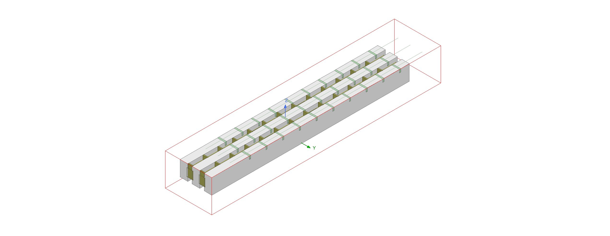
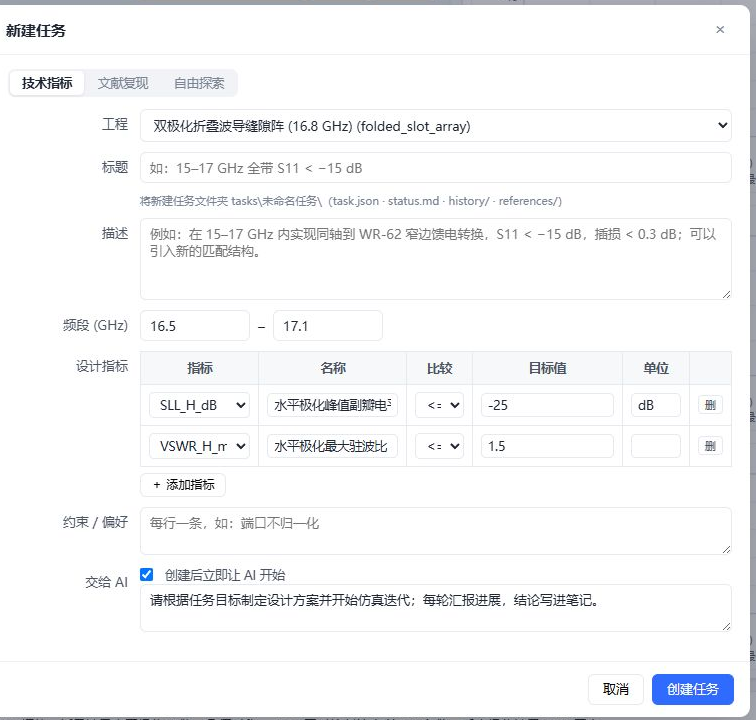
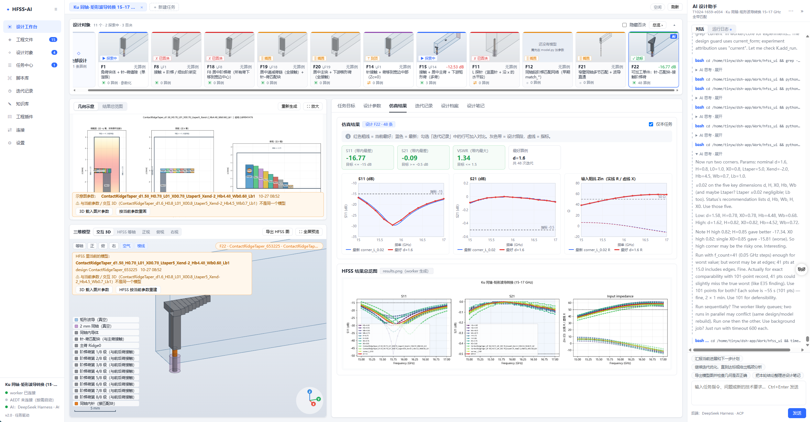
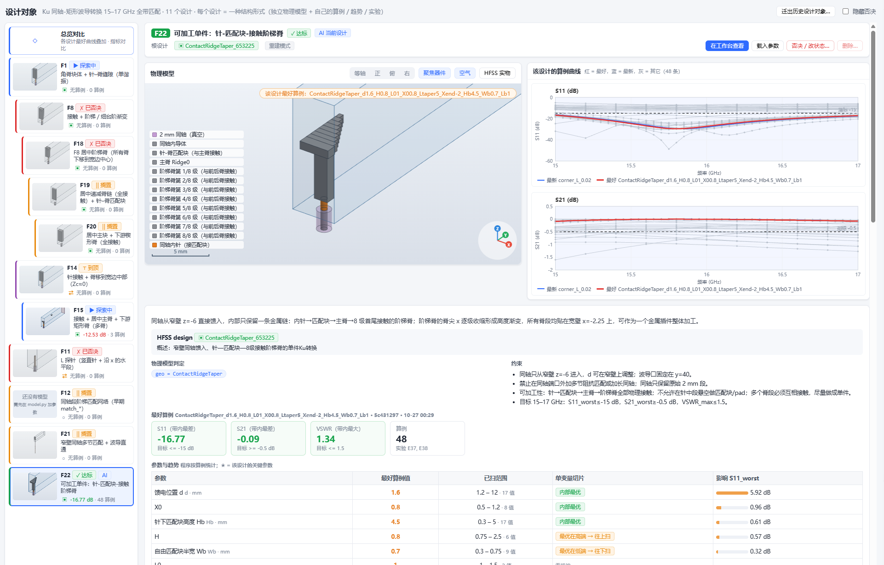
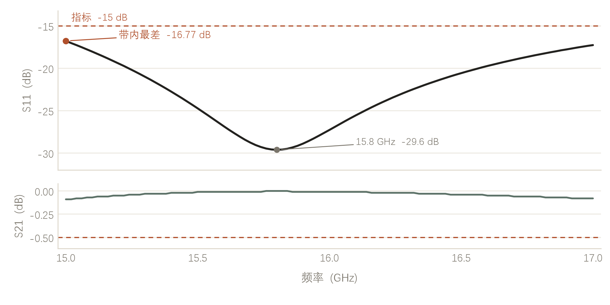
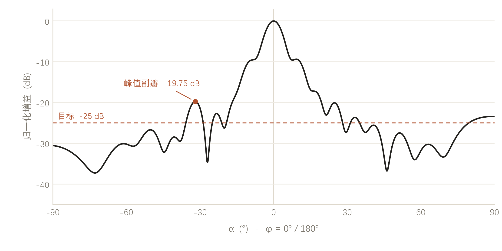

# HFSS-AI

**Let AI drive HFSS.**
Status: **in development — not released yet.** Join the waiting list below.

[中文](README.zh-CN.md) · [Intro deck (PDF)](docs/deck/HFSS-AI-Intro.pdf) · [Static page](docs/index.html) · [Waiting list](mailto:woodybuendia@gmail.com?subject=HFSS-AI%20waiting%20list)

> You write one sentence. It builds the model, runs the design, and keeps the record.

**Beyond MCP and skills — it understands the task, understands the model, designs and optimizes on its own, and never loses the thread.**

---

## Built around the task

A design task is the unit of work — not a button, not a menu.

You describe the device — band, targets, constraints, what must not change — and hand it over.
The AI uses ANSYS HFSS the way a designer would: it writes the model script, sets ports and meshes,
sweeps parameters, reads the curves, decides what to try next, and keeps every decision attached
to the task.

Nothing is hidden in a chat log. Parameters, results, history and notes live in the task folder,
so the next person can pick it up without interrogating anyone.

## Not another "assistant" bolted onto a simulator

We deliberately did not wrap HFSS into a fixed set of buttons. The whole toolchain — geometry,
ports, meshes, sweeps, result extraction — is exposed to the agent, which writes and debugs its own
scripts against it.

> Anything the interface can do, it can do. Anything the interface cannot do, it writes.

That is the difference between *bolting an assistant onto a simulator* and *letting a designer work*:
the boundary is not the interface, it is the model and the physics.

## From one sentence to a delivered project

1. **You describe** — the device, the band, the specs, what must not move.
2. **It models** — parametric geometry, ports, mesh; written and debugged by the agent.
3. **It iterates** — sweeps, judges, changes route; if it is stuck, it says where.
4. **It delivers** — the `.aedt` project, the curves and the conclusions, filed under the task.

**You write the goal, not the steps.**

## A look inside

Find it, see it, ask it — on one screen. Designs and their state on the left, model, curves and
metrics in the middle, the agent's conversation on the right. (Real screenshot: the waveguide
transition task.)

One design, one object. Every structure type is filed separately — its own model, its own studies,
its own trend. Switching structure is turning a page, not reopening a tool. A task belongs to one
design object; a design object can hold many tasks.

## Both ends are swappable

**Upward — the AI.** A long-lived DSH · ACP session by default; Claude Code, OpenCode, Codex or
Gemini CLI as command-line agents; Anthropic and OpenAI-compatible APIs (DeepSeek, Qwen, Kimi,
Zhipu, local Ollama); or an inbox, handing the work to any agent that can write a script.
Swapping the model does not change the task.

**Downward — HFSS.** A resident worker on the remote workstation drives AEDT through PyAEDT, over
SSH, on the same host, or at a manual address. It restarts itself when the link drops, so long runs
do not start over.

> Swap the model, the task stays. Swap the machine, the task stays. Tasks, metric definitions and
> history all live on this side.

## Evidence, not promises

**Coaxial-to-rectangular waveguide transition, 15–17 GHz.** From −12.53 dB to **−16.77 dB**, about
4.2 dB. Tolerance re-checks at ±0.05 mm (single variable) and ±0.02 mm (combined) passed. Delivered.

**Dual-polarized folded-waveguide slot array, 16.8 GHz.** Target −25 dB, currently **−19.75 dB** —
5.25 dB to go. Extraction, metric definition and batch study are working; what is left is the
structure itself. Shown on purpose: the platform is in development, and it says so.

## Where it stands

**Working**

- The full loop for a single device: model, solve, judge, record
- Parallel comparison of candidate designs, with feasible ones filtered out automatically
- One definition for patterns, S-parameters and VSWR
- Resumable long runs; results exportable and re-checkable

**In progress**

- Design and optimization of complex arrays
- Manufacturing tolerance and manufacturability constraints
- From one design to a product
- Concurrent tasks

It is not a general-purpose simulation API; it is an experiment in putting AI into a real design
process.

## How to see the AI

Assistant? Replacement? Amplifier — each is only half right. The real difference is who carries the
judgement.

> It amplifies the designer’s judgement. It does not replace the designer.

The machine spreads out the possibilities; you tell it what you have in mind; it builds it.

## Join the waiting list

HFSS-AI is not publicly available yet. If you would like to try it when the first build is ready,
write to **woodybuendia@gmail.com** with the subject `HFSS-AI waiting list` — a short note about
your device and your HFSS setup helps us pick the first testers.

Every action in the interface, it can do; anything outside the interface, it writes.

---

This repository is an introduction only. It does not contain the source code of HFSS-AI.
Designed by WoodyBuendia · 2026
